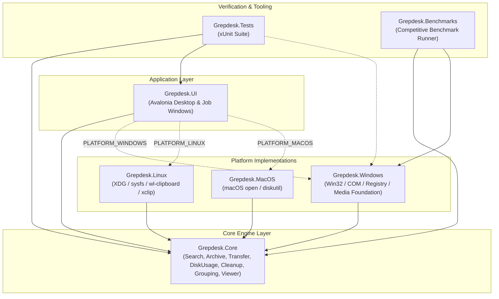
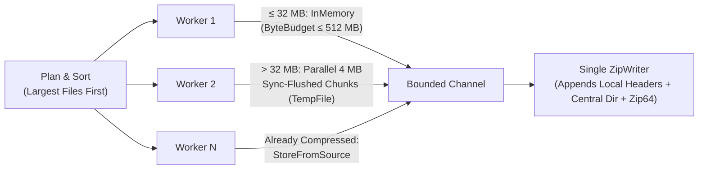
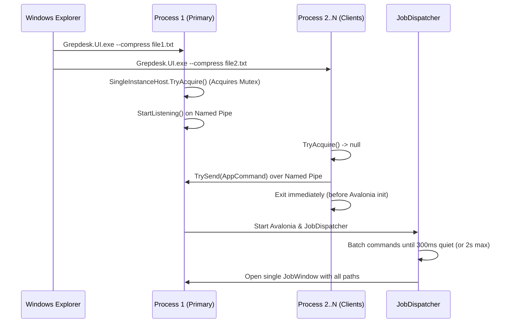

# Architecture & Developer Guide

This document describes the internal architecture, project boundaries, core algorithms, concurrency models, and platform abstractions of **Grepdesk**.

---

## 1. High-Level Overview

Grepdesk is built on **.NET 10** and **Avalonia UI**. All file-system engines, document parsers, analyzers, and business rules live in `Grepdesk.Core` with zero UI or OS-specific dependencies. Platform-specific capabilities (shell menus, native file copying, hardware media playback, drive hardware detection, and shell thumbnails/icons) are defined as interfaces in `Grepdesk.Core` and implemented per OS in `Grepdesk.Windows`, `Grepdesk.Linux`, and `Grepdesk.MacOS`.

---

## 2. Solution Projects

| Project | Target | Output | Responsibility |
| :--- | :--- | :--- | :--- |
| **`Grepdesk.Core`** | `net10.0` | Class Library | File indexing, content extraction, parallel zip/unzip, file transfer engine, disk usage analyzer, duplicate finder, cleanup analyzer/executor, smart folder grouping, DOCX/PDF viewer & editor models, and OS abstraction interfaces. |
| **`Grepdesk.UI`** | `net10.0` | `WinExe` | Avalonia UI views (`BrowseView`, `MainWindow`, `DiskUsageView`, `CleanupView`, `OrganizeView`), `FileViewerWindow`, `JobWindow`, single-instance IPC host, localization, settings, and crash diagnostics. |
| **`Grepdesk.Windows`** | `net10.0` | Class Library | Windows Explorer context-menu registration (`HKCU`), `CopyFile2` unbuffered copying, Win32 clipboard (`CF_HDROP` + `Preferred DropEffect`), `IShellItemImageFactory` thumbnails/icons, `StoragePropertyQuery` SSD/HDD detection, and Media Foundation playback. |
| **`Grepdesk.Linux`** | `net10.0` | Class Library | File manager context scripts (Dolphin, Nautilus, Nemo), `xclip`/`wl-clipboard` URI clipboard reading, `/sys/block/*/queue/rotational` drive detection, and freedesktop Trash (`~/.local/share/Trash`). |
| **`Grepdesk.MacOS`** | `net10.0` | Class Library | macOS `open -R` / Terminal / `diskutil info` SSD detection and `~/.Trash` integration. |
| **`Grepdesk.Tests`** | `net10.0` | Test Project | Unit, integration, installer sync, and performance guard tests (`Category=Performance`). |
| **`Grepdesk.Benchmarks`** | `net10.0` | Console `Exe` | Reproducible benchmark harness comparing Grepdesk against Windows Explorer COM, 7-Zip, `robocopy /MT:8`, and single-threaded .NET. |

---

## 3. Core Subsystems (`Grepdesk.Core`)

### 3.1 File Name Index (`FileIndex`)
Located in `Grepdesk.Core/FileIndex.cs`.
- **Parallel Directory Walk**: Uses a lock-free `ConcurrentQueue<string>` and `Partitioner.Create(..., EnumerablePartitionerOptions.NoBuffering)` across `Max(2, ProcessorCount - 1)` worker threads. Tracking an atomic `pending` folder counter ensures workers don't exit prematurely while large directories are still being enumerated.
- **Symlink & Cloud Safety**: Reparse points (symlinks/junctions) are listed as entries but not traversed to prevent infinite loops and double-counting. Online-only cloud placeholders (`RecallOnDataAccess = 0x00400000` or `FileAttributes.Offline`) are flagged (`IsCloudOnly`) so their logical size does not inflate disk or folder totals.
- **Bottom-Up Folder Size Rollup**: After indexing completes, `ComputeFolderSizes` aggregates file sizes into parent directories and sorts directories by descending path length (`OrderByDescending(p => p.Length)`). Because a child path is always longer than its parent path, every subfolder's total is finalized before being added to its parent in a single bottom-up pass.
- **Memory Layout**: Stores `IndexEntry(bool IsDirectory, long Size, DateTime Modified, bool IsCloudOnly)` keyed by full path. The file name is never stored separately; `NameOf(path)` slices the tail of the key as a `ReadOnlySpan<char>` to save millions of string allocations on full-disk scans.
- **Live Updates & Fast Bulk Removal**: Attaches `FileSystemWatcher` instances to indexed roots. When Grepdesk deletes or moves many items at once, `RemoveMany` normalizes and de-nests folder prefixes, then uses `Array.BinarySearch` per index key for allocation-free $O(N \log M)$ pruning.

### 3.2 Folder Browser (`Grepdesk.Core/Browse`)
- **`FolderListing`**: Lists direct children of a folder using `EnumerationOptions`, sorts folders before files using natural numeric ordering (`CompareOptions.NumericOrdering` so `file2` precedes `file10`), and computes bounded recursive subfolder sizes (`DefaultMaxAutoBytes = 1 GB`, `DefaultMaxAutoEntries = 5,000`) while skipping known huge roots (`C:\`, `C:\Windows`, `C:\Users`, `Program Files`, `AppData`) unless explicitly requested.
- **`AddressResolver`**: Resolves typed paths, environment variables (`%APPDATA%`, `$HOME`), `~`, and relative segments into normalized absolute paths.
- **`NavigationHistory`**: Manages back/forward stacks and parent traversal.
- **`FileNames`**: Validates file/folder names against OS rules (e.g., Windows reserved device names `CON`, `PRN`, `AUX`, `NUL`, `COM1`–`COM9`, `LPT1`–`LPT9`, trailing dots/spaces, and invalid characters).

### 3.3 Deep Content Search (`Grepdesk.Core/ContentSearch`)
- **`ContentSearcher`**: Streams `ContentMatch(FullPath, Snippet)` via `IAsyncEnumerable<ContentMatch>` backed by an unbounded `Channel<ContentMatch>` and a `SemaphoreSlim` limiting concurrency to `Clamp(ProcessorCount, 2, 8)`.
- **Safety Cap & Skip Reporting**: Files larger than 20 MB (`MaxFileSizeBytes`) or files that fail extraction (encrypted/corrupt) are reported through the `Action<SkippedFile>? onSkipped` callback rather than silently ignored or halting the scan.
- **`ExtractorRegistry` & Extractors**:
  - `PlainTextExtractor`: Reads source code, configuration, and plain text files (`.txt`, `.md`, `.cs`, `.py`, `.js`, `.ts`, `.json`, `.xml`, `.yaml`, `.sql`, etc.).
  - `PdfExtractor`: Extracts text page-by-page using `UglyToad.PdfPig`.
  - `DocxExtractor`: Opens `.docx` archives and extracts text from `word/document.xml` without external dependencies.
  - `XlsxExtractor`: Parses shared strings (`xl/sharedStrings.xml`) and inline worksheet cells from `.xlsx` archives.

### 3.4 Parallel Archive Engine (`Grepdesk.Core/Archive`)
Grepdesk implements its own ZIP container writer (`ZipWriter`) so multiple worker threads can compress entries in parallel without serializing on `System.IO.Compression.ZipArchive`.

- **`ZipCompressor`**:
  - **Largest-First Scheduling**: Plans all input files up front and sorts them descending by size so a job never finishes with a single thread stuck on a huge file while other cores sit idle.
  - **Incompressible Detection**: Known compressed extensions (`.jpg`, `.png`, `.mp4`, `.zip`, `.7z`, `.pdf`, `.docx`, etc.) and files where Deflate does not shrink the data are stored uncompressed (`MethodStored`).
  - **Small Files ($\le 32\text{ MB}$)**: Read into pooled arrays (`ArrayPool<byte>`), hashed with `Crc32`, and deflated in memory under a global 512 MB `ByteBudget`.
  - **Large Files ($> 32\text{ MB}$)**: First tests a 4 MB sample chunk; if it shrinks by less than 3% (`WorthCompressingRatio = 0.97`), the file is stored directly from the source. Otherwise, the file is split into 4 MB chunks deflated concurrently across cores using `DeflateStream.Flush()` (sync flush on byte boundaries, the same technique used by `pigz`) into a temporary file, forming a single valid Deflate stream.
  - **Atomic Output**: Writes to `<archive>.zip.partial` and renames on completion; deletes partial and temp files on cancellation or error.
- **`ZipWriter`**: Writes local file headers, data payloads, central directory headers, and Zip64 end-of-central-directory records (supporting archives $> 4\text{ GB}$ and $> 65,535$ entries) with UTF-8 filenames.
- **`ZipExtractor`**:
  - Plans all archives up front, checking every entry against **Zip Slip** path traversal (`!target.StartsWith(destinationPrefix)`).
  - Pre-creates directories and orders entries by `CompressedLength` descending.
  - Each worker opens its own `FileStream(..., FileOptions.RandomAccess)` + `ZipArchive` and pre-sizes target files (`destination.SetLength(file.Length)`) to reduce filesystem fragmentation.
  - Smart **Extract Here** (`ResolveExtractHereDestination`): extracts directly next to the archive if the zip contains a single top-level folder, or into a subfolder named after the archive if loose files sit at the root.

### 3.5 File Transfer Engine (`Grepdesk.Core/Transfer`)
- **Producer-Consumer Pipeline**: `TransferEngine` starts copying immediately without an upfront "calculating size" phase. A single producer task walks source directories, creates target folders before queuing their files, updates total bytes dynamically, and writes `FileWork` items to a bounded channel (`Capacity = 4096`).
- **Same-Volume Instant Move**: When moving on the same volume with no destination conflict, `Directory.Move` / `File.Move` performs an instant metadata rename.
- **Platform Copy (`IFileCopier`)**:
  - On Windows (`CopyFile2Copier`), uses Win32 `CopyFile2` with `COPY_FILE_NO_BUFFERING` for files $\ge 256\text{ MB}$ so multi-gigabyte copies don't evict the OS file cache, and wires the native progress callback directly to `JobContext` for instant pause and cancellation.
  - On Linux/macOS (`NativeFileCopier`), uses `File.Copy` for files $\le 4\text{ MB}$ (leveraging kernel `copy_file_range` / `clonefile` reflinks) and a pooled 1 MB stream loop for larger files so pause/cancel checkpoints remain responsive.
- **Transient Lock Retry**: Automatically retries `ERROR_SHARING_VIOLATION` / `ERROR_LOCK_VIOLATION` (`EWOULDBLOCK` on Unix) up to 3 times with a 500 ms backoff, rolling back partial byte progress between attempts.

### 3.6 Hardware-Aware Concurrency (`WorkerPolicy`)
Located in `Grepdesk.Core/DriveKind.cs`. Parallel I/O speeds up SSDs and network shares but causes severe head thrashing on spinning HDDs and USB flash drives:
- **`WorkerPolicy.FileOperations`** (Copy, Move, Extract):
  - Any `Rotational` (HDD) or `Removable` drive involved: **1 worker**
  - Any `Network` share involved: **16 workers**
  - All `SolidState` (SSD/NVMe): **32 workers**
  - `Unknown`: **4 workers**
- **`WorkerPolicy.Compression`** (Zip):
  - Any `Rotational` or `Removable` drive: **1 worker**
  - All `SolidState`: **`Environment.ProcessorCount` workers**
  - Otherwise: **`Min(4, Environment.ProcessorCount)` workers**

### 3.7 Disk Usage Analyzer (`Grepdesk.Core/DiskUsage`)
- **`DiskClassifier`**: Classifies paths by location first, then by extension. For example, a `.mp4` cutscene inside `Steam\steamapps\common\SomeGame\` is classified under `DiskCategory.Games` with a `GroupLength` pointing to the `SomeGame` folder. Recognizes Games (Steam, Epic, GOG, Riot, Xbox, Battle.net, EA, Ubisoft), Developer tools & AI caches (`.nuget`, `node_modules`, `.ollama`, `.lmstudio`, HuggingFace, Docker, Android SDK, JetBrains, Visual Studio, Cargo, Go), Apps, System & Caches, Videos, Pictures, Documents, Music, Archives, and Other.
- **`DiskAnalyzer`**: Single-pass aggregation over `FileIndex`. Uses `Dictionary.GetAlternateLookup<ReadOnlySpan<char>>()` to group millions of files into application/game folders without allocating substring keys, and maintains per-category min-heaps (`PriorityQueue<SearchResult, long>`) for top largest files. Reports `CloudOnlyBytes` and `UnreadableBytes` (`UsedBytes - ScannedBytes`) explicitly.

### 3.8 Space Cleanup & Duplicate Finder (`Grepdesk.Core/Cleanup`)
- **`CleanupAnalyzer`**: Zero-I/O analysis over `FileIndex` identifying:
  - `TempFiles` ($> 1$ day old, grouped by top-level item in `%TEMP%` and `C:\Windows\Temp`)
  - `Caches` (browser caches, Electron `Cache_Data`/`Code Cache`/`GPUCache`, NVIDIA/AMD/DirectX shader caches, Firefox `cache2`; `Service Worker` offline storage is listed but unselected by default)
  - `DeveloperCaches` (npm, pip, NuGet, Yarn, pnpm, Gradle caches, and `node_modules` untouched for $> 90$ days)
  - `OldDownloads` ($> 90$ days old in Downloads, unselected by default, action: `MoveToTrash`)
  - `LargeOldFiles` ($\ge 500\text{ MB}$ and $> 365$ days old among user files, unselected by default, action: `MoveToTrash`)
  - `Hibernation` (`hiberfil.sys`, informational with admin command instructions)
- **`DuplicateFinder`**: Three-stage narrowing pipeline over user files (`DiskClassifier` excludes system, app, game, and developer folders where identical files are required):
  1. **Pass 1 (Size)**: Groups candidate files by exact byte length from `FileIndex` (0 disk reads).
  2. **Pass 2 (64 KB Head + Tail Sample)**: Computes `XxHash128` of the first 64 KB and last 64 KB (`MaxDegreeOfParallelism = 4`). Files $\le 128\text{ KB}$ are fully hashed by this pass and need no further reads.
  3. **Pass 3 (Full `XxHash128`)**: Streams remaining candidates in 1 MB pooled buffers (`MaxDegreeOfParallelism = 2`) with byte-level progress reporting.
- **`PathAnonymizer`**: Scrubs usernames and personal folder names from paths before copying cleanup summaries for the optional "Ask AI" helper dialog.

### 3.9 Smart Folder Grouping (`Grepdesk.Core/Grouping`)
- **`FolderGrouper`**: Purely deterministic, local rule-based grouping with 5 modes:
  - **`Series` (Smart)**: Three narrowing passes:
    1. *Exact Pattern*: Replaces UUIDs, ISO/text dates (English & Turkish month names), hex IDs, numbers, and copy markers (`(1)`, `- Copy`, `- Kopya`) with `*` (e.g., `dracula_idle_1.png`..`37.png` $\rightarrow$ `dracula_idle_*.png`).
    2. *Word Families*: Groups remaining files sharing the same extension and initial word ($\ge 3$ letters), computing their longest shared word-boundary prefix (e.g., `Microsoft.Extensions`).
    3. *Type Bucket*: Groups remaining files by `TypeBucket` (`Installers`, `Archives`, `DiskImages`, `Documents`, `Images`, `Videos`, `Audio`, `Code`, `Fonts`, `Torrents`, `Folders`, `Other`).
  - **`Source`**: Reads the NTFS `:Zone.Identifier` Alternate Data Stream attached by browsers and extracts the domain from `ReferrerUrl` (preferred over CDN `HostUrl`).
  - **`Type`**: Groups all items directly by `TypeBucket`.
  - **`Session`**: Clusters files whose `LastWriteTime` timestamps are separated by no more than 30 minutes (`SessionGap`).
  - **`Redundant` (Leftovers)**: Detects archives whose extracted folder sits beside them (`project.zip` next to `project\`) and repeated downloads (`setup (1).exe` next to `setup.exe` with identical byte size).
- **`FolderOrganizer`**: Executes group moves into subfolders (never overwriting existing files) and maintains an undo log to move files back and remove the created subfolder in one click.

### 3.10 Document Viewer & Editor (`Grepdesk.Core/Viewer` & `Grepdesk.UI/Viewer`)
- **Word Documents (`DocxDocument` & `DocxEditDocument`)**:
  - `DocxDocument` parses `word/document.xml`, `styles.xml`, `numbering.xml`, `theme1.xml`, headers/footers, footnotes/endnotes, tables (including horizontal `gridSpan` and vertical `vMerge`), images, hyperlinks, and `PAGE`/`NUMPAGES` fields into page-laid-out `DocxBlock` trees.
  - `DocxEditDocument` holds all ZIP package entries in memory and binds each editable `<w:p>` element to a `DocxEditParagraph` composed of `TextPiece` and `NodePiece` items. Non-text XML nodes (drawings, bookmarks, comments, fields) are preserved in place as `NodePiece`s, and saving rewrites only modified XML parts while leaving every other part in the `.docx` archive byte-for-byte untouched.
- **PDF Rendering (`PdfRenderer`)**: Renders PDF pages on demand via `Docnet.Core` (PDFium) into BGRA bitmaps with zoom support.
- **Text & Code Editor (`FileViewerWindow`)**: Uses `AvaloniaEdit` + `TextMateSharp` grammars. Detects and preserves original file encodings (UTF-8 with/without BOM, UTF-16 LE/BE, or system code page) and line endings (`CRLF` vs `LF`).
- **Media Playback (`IMediaPlayback` / `MediaFoundationPlayback`)**: On Windows, decodes video and audio using native Media Foundation COM interfaces into Avalonia writeable bitmaps with hardware-accelerated codecs.

---

## 4. Single-Instance Job Batching & IPC (`Grepdesk.UI/Startup`)

When a user selects 50 files in Windows Explorer and clicks **Compress with Grepdesk**, Explorer spawns 50 separate `Grepdesk.UI.exe` processes almost simultaneously. Grepdesk merges these into a single job window without paying Avalonia's startup cost 50 times:

1. **`SingleInstanceHost`**: Uses a per-user mutex (`Local\Grepdesk.Jobs.<SHA256(Domain\User)[..16]>`) and a named pipe (`Grepdesk.Jobs.<Hash>`).
2. **`JobDispatcher`**: Batches incoming commands of the same `CommandKind` (`ExtractHere`, `ExtractTo`, `Compress`) until arrivals are quiet for **300 ms** (`QuietPeriod`) or **2 seconds** (`MaxWait`) have elapsed since the first arrival, then opens a single `JobWindow`. (`Paste` commands are never merged because each paste targets its own destination directory.)
3. When the last `JobWindow` closes, `JobDispatcher` calls `host.StopAccepting()`, drains any late pipe messages, and shuts down the process.

---

## 5. Platform Abstraction Matrix

`PlatformShellFactory` (`Grepdesk.UI/Helpers/PlatformShellFactory.cs`) binds the compile-time constant (`PLATFORM_WINDOWS`, `PLATFORM_LINUX`, `PLATFORM_MACOS`) to the platform implementation:

| Interface | Windows (`Grepdesk.Windows`) | Linux (`Grepdesk.Linux`) | macOS (`Grepdesk.MacOS`) |
| :--- | :--- | :--- | :--- |
| **`IPlatformShell`** | `WindowsShell` (`explorer.exe /select`, `wt.exe`/`powershell.exe`, `SHFileOperationW` Recycle Bin, `SHQueryRecycleBinW`, `SHEmptyRecycleBinW`) | `LinuxShell` (`xdg-open`, `dbus-send` FileManager1, terminal emulators, freedesktop `~/.local/share/Trash`) | `MacShell` (`open`, `open -R`, `open -a Terminal`, `~/.Trash`, `osascript` Finder empty trash) |
| **`IShellIntegration`** | `WindowsShellIntegration` (`HKCU\Software\Classes` verbs, `Grepdesk.File` ProgId, `OpenWithProgids`) | `LinuxShellIntegration` (KDE Dolphin `.desktop` servicemenus, GNOME Nautilus scripts, Cinnamon Nemo actions) | `null` (Finder requires signed App Extension) |
| **`IDriveKindProvider`** | `WindowsDriveKindProvider` (`DeviceIoControl` `IOCTL_STORAGE_QUERY_PROPERTY` for seek penalty / bus type) | `LinuxDriveKindProvider` (`/proc/self/mountinfo` + `/sys/block/<dev>/queue/rotational` & `removable`) | `MacDriveKindProvider` (`diskutil info` `Solid State` / `Removable Media`) |
| **`IFileCopier`** | `CopyFile2Copier` (Win32 `CopyFile2`, unbuffered $\ge 256\text{ MB}$) | `NativeFileCopier` (`File.Copy` $\le 4\text{ MB}$, 1 MB stream loop $> 4\text{ MB}$) | `NativeFileCopier` |
| **`IFileClipboard`** | `Win32FileClipboard` (`CF_HDROP` + `Preferred DropEffect` for Copy vs Cut) | `LinuxFileClipboard` (`wl-paste` / `xclip`, `x-special/gnome-copied-files`, `text/uri-list`) | `null` |
| **`IShellPreview`** | `WindowsShellPreview` (`IShellItemImageFactory` thumbnails + Shell property store duration/dimensions) | `null` (falls back to cross-platform preview providers) | `null` |
| **`IShellIcons`** | `WindowsShellIcons` (`IShellItemImageFactory` `SIIGBF_ICONONLY` on dedicated STA thread, cached) | `null` (renders file type badges) | `null` |
| **`IMediaPlayback`** | `MediaFoundationPlayback` (COM `IMFSourceReader` + `IMFSinkWriter` / audio renderer) | `null` | `null` |

---

## 6. Diagnostics, Crash Recovery & Persistent Data

### 6.1 Three-Tier Error & Crash Handling
1. **`ErrorLog`** (`Grepdesk.UI/ErrorLog.cs`): Writes unhandled exceptions and diagnostics to rolling daily logs (`grepdesk-YYYY-MM-DD.log`, keeping the latest 10 files) in:
   - **Windows**: `%LOCALAPPDATA%\Grepdesk\logs`
   - **Linux / macOS**: `~/.local/share/Grepdesk/logs`
2. **`CrashHandling`** (`Grepdesk.UI/CrashHandling.cs`): Installs handlers on `AppDomain.CurrentDomain.UnhandledException`, `TaskScheduler.UnobservedTaskException`, and `Dispatcher.UIThread.UnhandledException`. UI-thread exceptions are caught, logged, and displayed in a non-fatal dialog with "Copy details" and "Open log folder" buttons.
3. **`SessionTrail`** (`Grepdesk.UI/SessionTrail.cs`): Native crashes (e.g., inside PDFium, Media Foundation, or a GPU driver) terminate the process before managed handlers can run. Every running Grepdesk process records its last 80 actions (deduplicating consecutive identical events as `(×N)`) into `session-<PID>.trail` inside the log folder and deletes the file on normal exit. On the next launch, `SessionTrail.TakeCrashes()` detects orphaned trail files from the current OS boot session, queries the Windows Application Event Log (`wevtutil` Event IDs `1000` and `1026`) for the faulting native module and exception code, logs the combined report, and shows a crash summary dialog.

### 6.2 User Settings (`AppSettings`)
Stored in `%APPDATA%\Grepdesk\settings.json` on Windows (`~/.config/Grepdesk/settings.json` on Linux):
- `Language`: ISO language code (`"en"`, `"tr"`, or `null` to follow OS culture)
- `Sort`: Search result sort order
- `ShowPreview`: Preview pane visibility
- `ShowHiddenFiles`: Hidden/system file visibility in the Files browser
- `LastBrowseFolder`, `BrowseSortColumn`, `BrowseSortDescending`: Persisted state for the Files browser
- `OpenWithFileTypes`: Custom list of extensions registered for "Open with Grepdesk"
- `CheckForUpdates`, `LastUpdateCheck`, `AvailableUpdateVersion`, `AvailableUpdateUrl`: Opt-in GitHub release checker state

### 6.3 Localization (`LocalizationService`)
UI strings live in `Grepdesk.UI/Assets/Lang/en.json` and `tr.json`. `LocalizationService.Instance["Key"]` returns the localized string for the active language, falling back to English (`en.json`) or the key name itself if missing. Changing the language in Settings updates all open views and rewrites enabled Explorer context-menu verbs in the new language.

---

## 7. Testing & Benchmarks

- **Unit & Integration Tests (`Grepdesk.Tests`)**: Covers `FileIndex`, `FolderListing`, `AddressResolver`, `ContentSearcher`, `ZipCompressor`, `ZipExtractor`, `ZipWriter`, `TransferEngine`, `DiskAnalyzer`, `CleanupAnalyzer`, `DuplicateFinder`, `FolderGrouper`, `DocxDocument`, `DocxEditDocument`, `AppCommand`, `SingleInstanceHost`, `ErrorLog`, `SessionTrail`, `UpdateChecker`, `WindowsShellIntegration` (including verifying that `setup.iss` uninstall registry keys match `WindowsShellIntegration.AllKeyPaths`), and Linux/macOS providers.
- **Performance Guard Tests**: Marked with `[Trait("Category", "Performance")]` in `Grepdesk.Tests/BenchmarkTests.cs`. Enabled by setting `$env:GREPDESK_PERF = "1"`. Asserts that Grepdesk's engines remain faster than single-threaded .NET and Windows Explorer.
- **Benchmark Suite (`Grepdesk.Benchmarks`)**: Generates deterministic synthetic datasets (10,000 source files, 306 media files, and 1 GB large files) and benchmarks Grepdesk against Explorer COM, 7-Zip, `robocopy /MT:8`, and single-threaded .NET, verifying output integrity after each run.
